# CST8912 – Graded Lab Activity 4

## Azure SQL Database and Azure Data Factory

**Name:** Samuel Vachon  
**Student Number:** 041101891  
**Date:** October 9, 2026

## Objective

Deploy an Azure SQL database, query its sample data, and use Azure Data Factory to copy the SalesLT.Product table into a CSV file in Azure Blob Storage.

## Resources Used

| Resource             | Configuration                              |
| -------------------- | ------------------------------------------ |
| Resource group       | CST8912-demo                               |
| SQL database         | db8912                                     |
| SQL server           | db8912demo-041101891                       |
| SQL region           | Canada Central                             |
| SQL compute          | General Purpose, Serverless, Gen5, 1 vCore |
| Backup redundancy    | Locally redundant                          |
| Sample database      | AdventureWorksLT                           |
| Storage account      | st8912sv041101891                          |
| Storage region       | Canada Central                             |
| Storage performance  | Standard                                   |
| Storage redundancy   | LRS                                        |
| Container            | productdata8912, private                   |
| Data Factory         | adf8912-041101891                          |
| Data Factory region  | Canada East                                |
| Data Factory version | V2                                         |
| Pipeline             | CopyProductsToBlob                         |
| Output file          | products.csv                               |

## 1. Create the SQL Database

I created db8912 in CST8912-demo using a SQL server in Canada Central. I selected Development, disabled the elastic pool option, and used locally redundant backup storage.

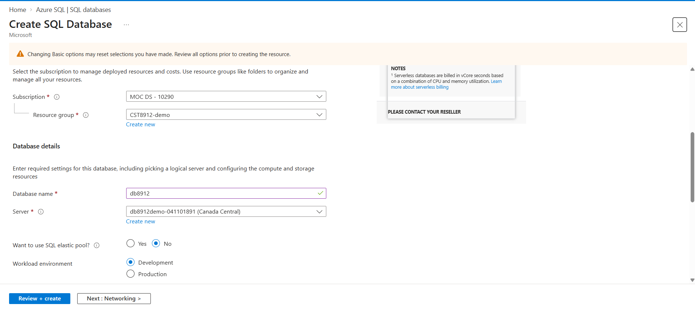

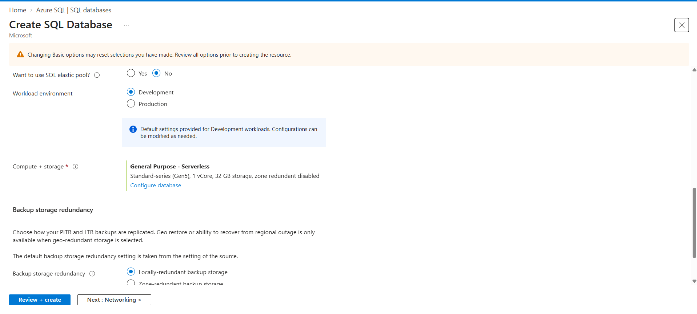

## 2. Configure Networking and Sample Data

I configured a client IP firewall rule for access to the SQL server. The networking screenshot shows that the “Allow Azure services and resources to access this server” exception was unchecked at the time of capture. This differs from the lab instructions.

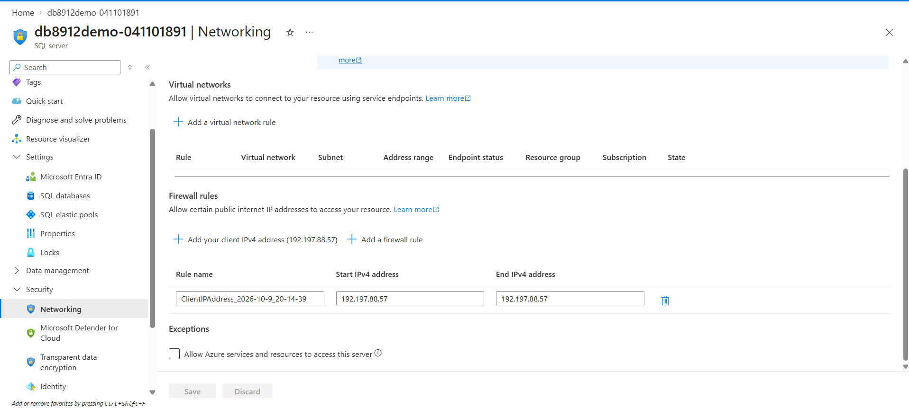

I selected Sample under Additional settings to load AdventureWorksLT.

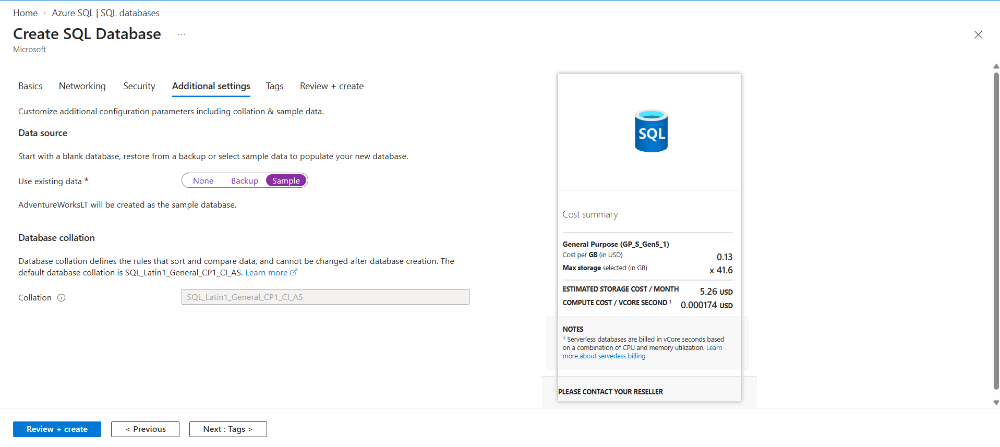

The deployed database was Online in Canada Central.

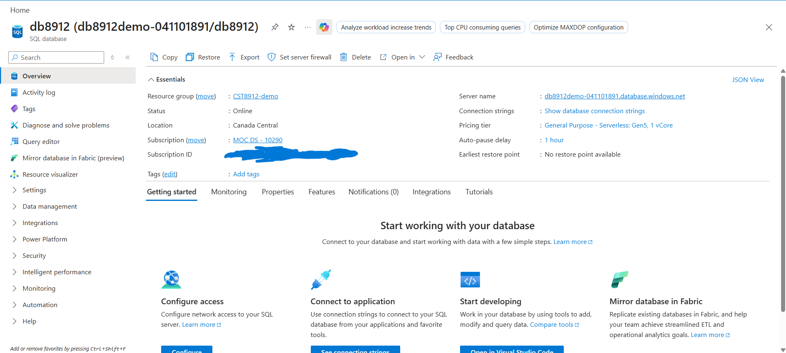

## 3. Query the Database

I signed into Query Editor and ran the following query:

```sql
SELECT ProductID, Name, ListPrice, ProductCategoryID
FROM SalesLT.Product;
```

The query succeeded and returned 295 rows containing product IDs, names, prices, and category IDs.

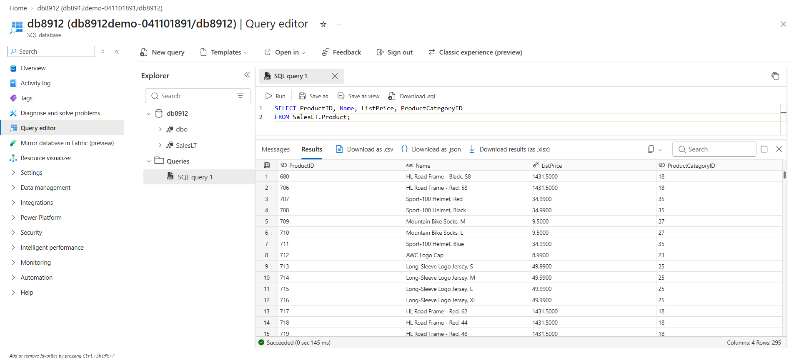

I then joined the Product and ProductCategory tables:

```sql
SELECT p.ProductID, p.Name AS ProductName,
       c.Name AS Category, p.ListPrice
FROM SalesLT.Product AS p
JOIN SalesLT.ProductCategory AS c
    ON p.ProductCategoryID = c.ProductCategoryID;
```

This query also returned 295 rows. The JOIN matched category IDs to display readable category names alongside the products.

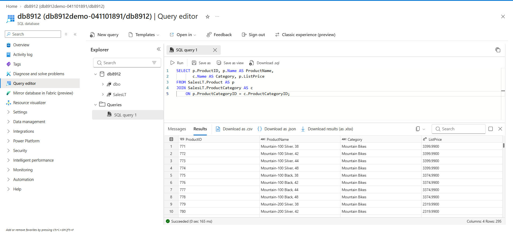

## 4. Create Blob Storage

I created a Standard storage account in Canada Central with locally redundant storage.

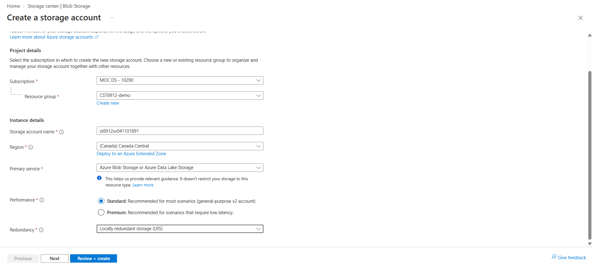

I created the private container productdata8912 to hold the exported file.

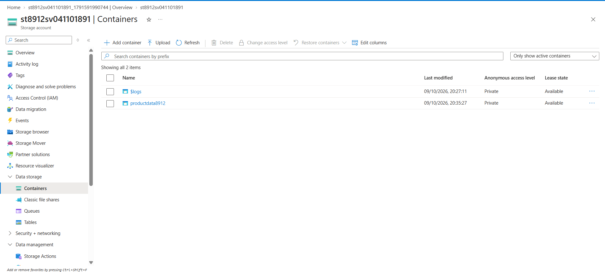

## 5. Create Azure Data Factory

I created a V2 Data Factory in CST8912-demo and launched Data Factory Studio.

The factory was configured in Canada East rather than Canada Central as shown in the lab reference. The copy operation still completed successfully, but this was a configuration difference from the instructions.

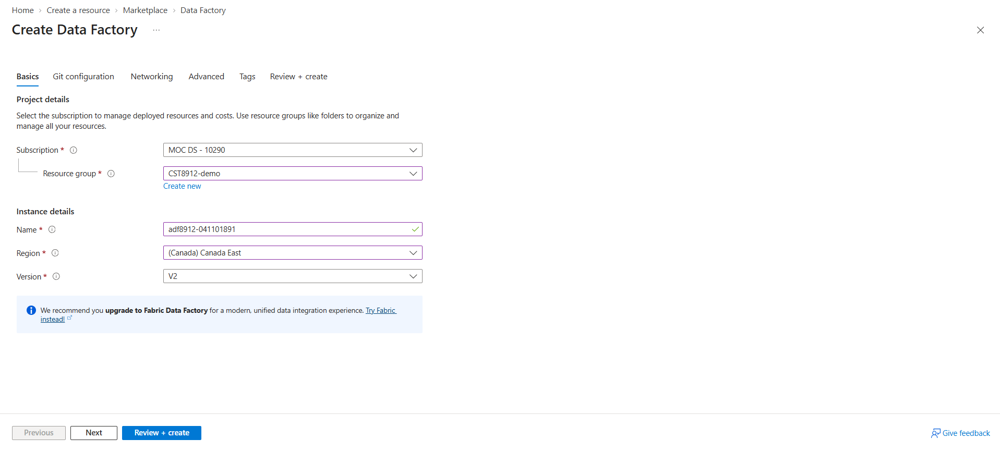

## 6. Configure the Source

Using the Ingest tool, I configured a built-in copy task to run once. I connected to Azure SQL Database using AzureSqlDatabaseConnection.

The connection loaded the database tables, and I selected SalesLT.Product as the source.

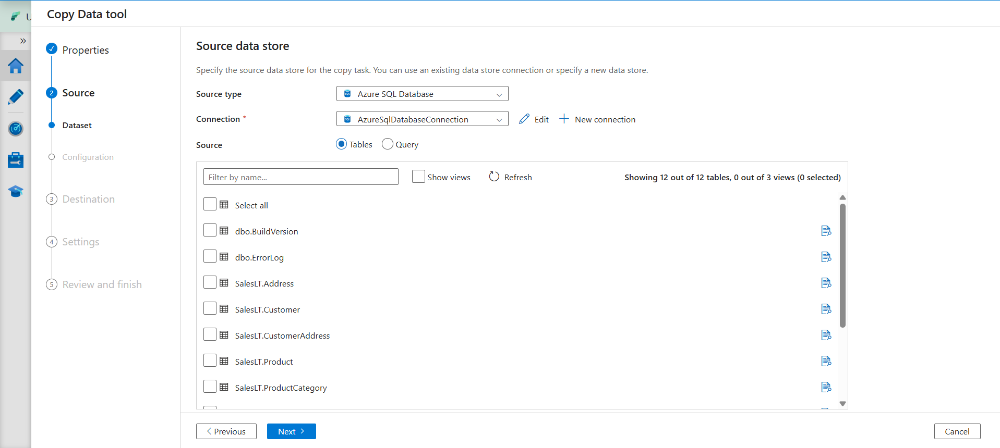

I previewed the product records before configuring the destination.

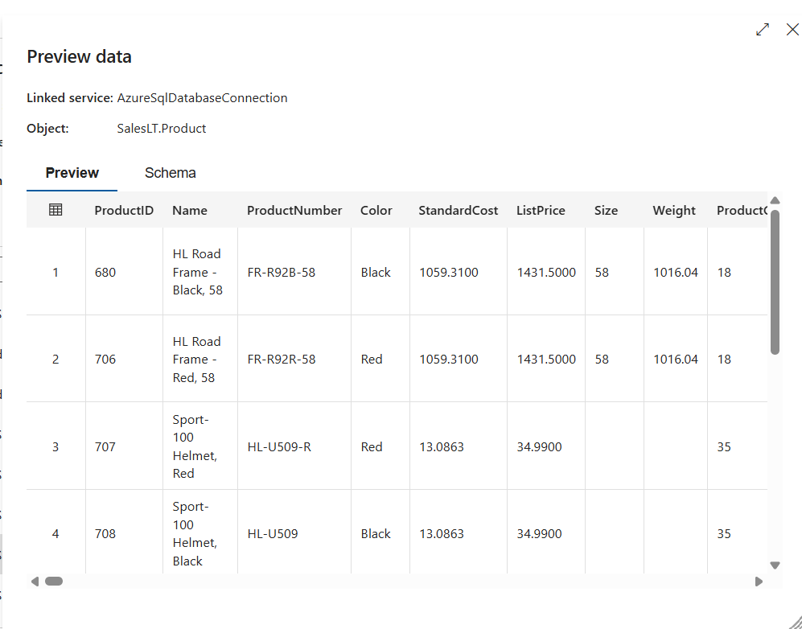

## 7. Configure the Destination

I created AzureBlobStorageConnection using account-key authentication. The connection test succeeded.

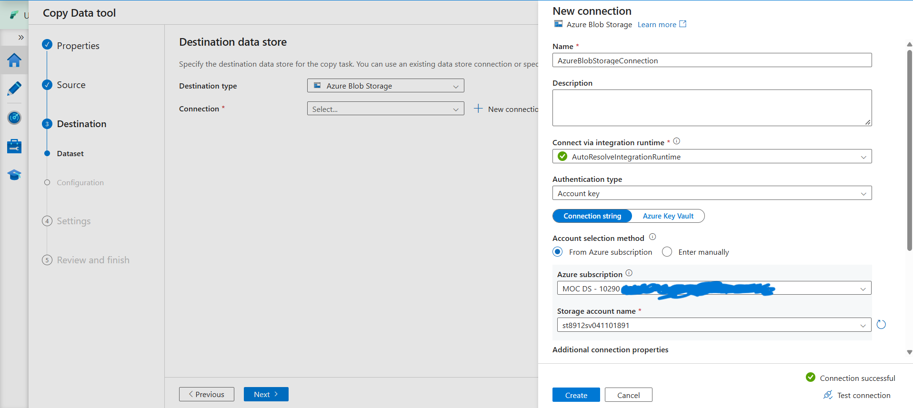

I selected productdata8912 as the destination container and products.csv as the filename.

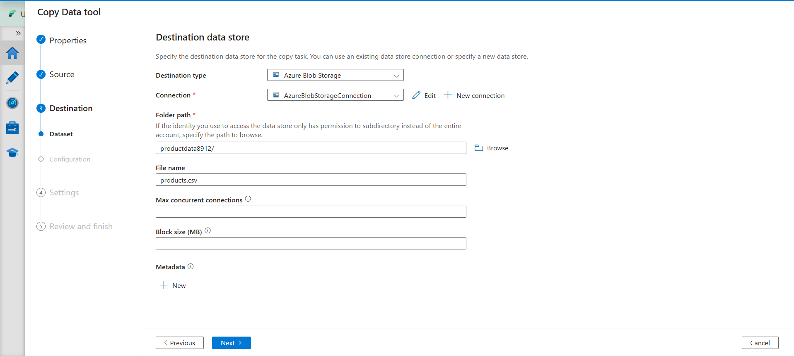

The output settings were:

- Format: DelimitedText
- Column delimiter: Comma
- Row delimiter: Default
- Header row: Enabled
- Compression: None

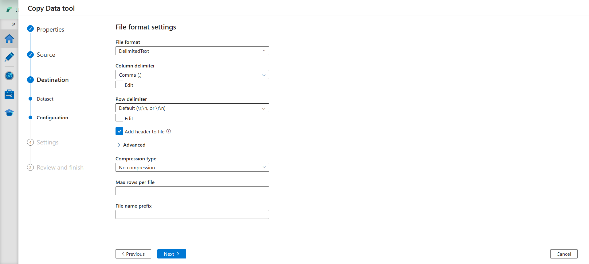

## 8. Run and Verify the Pipeline

I reviewed and deployed the CopyProductsToBlob pipeline.

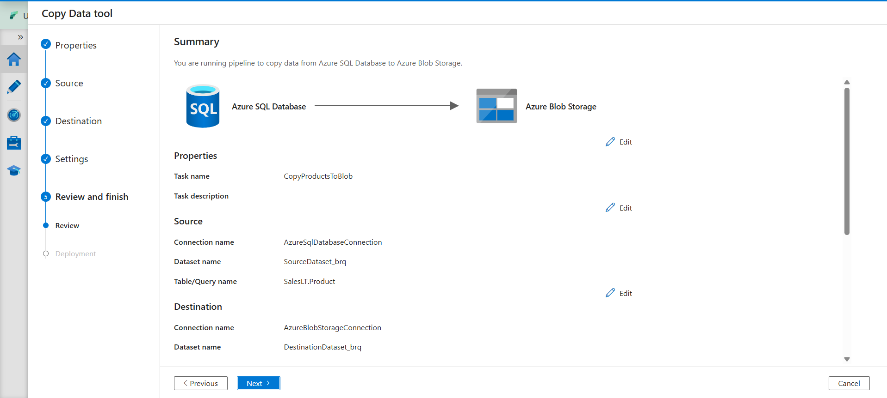

The pipeline completed with a Succeeded status in 27 seconds.

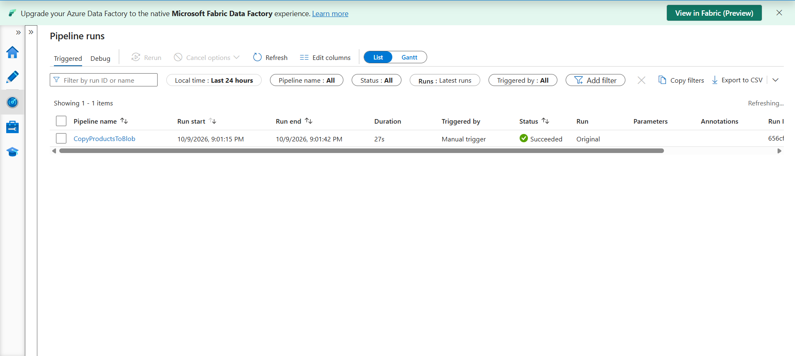

I verified that products.csv appeared in productdata8912. The blob was approximately 1.3 MiB.

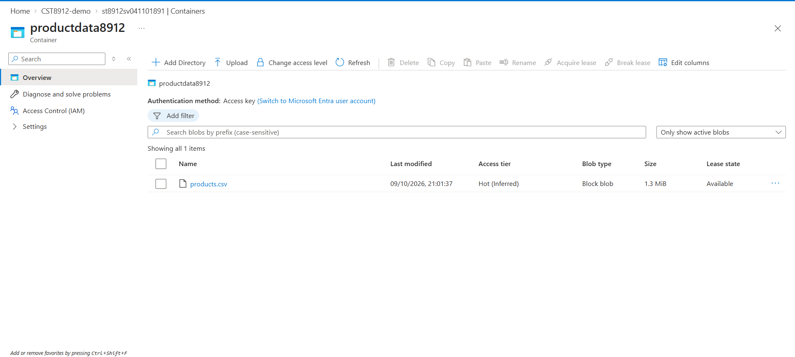

I downloaded the file and opened it in Excel. It contained column headers and product records.

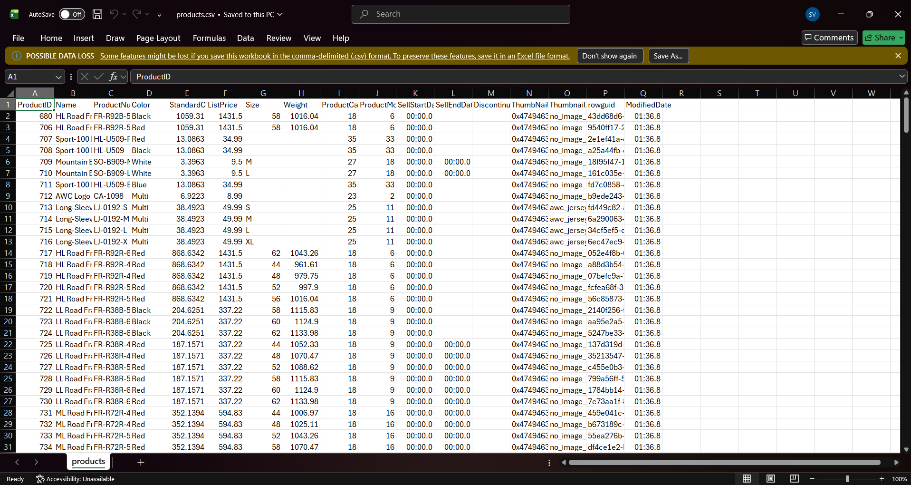

## Findings and Analysis

Azure SQL Database stored the relational product data, while Azure Blob Storage held the exported CSV. Azure Data Factory connected the two services and performed the copy without requiring a custom program.

The two SQL queries demonstrated selecting columns and joining related tables. The copy task exported the full Product table, so the CSV contained more columns than the first SQL query.

The successful pipeline status and the downloaded CSV provided evidence that the transfer worked. However, these results do not remove the configuration differences noted above.

## 9. Cleanup

After saving the screenshots and downloading the CSV, I deleted the resources created for this lab.

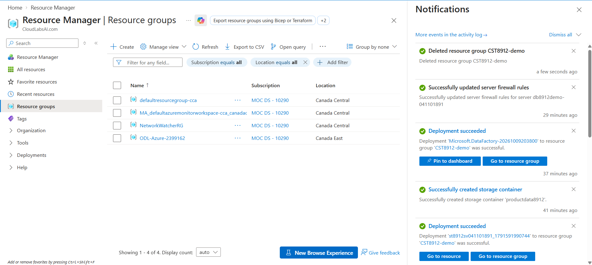

## Conclusion

I deployed and queried an Azure SQL database and successfully copied its product data into Azure Blob Storage using Azure Data Factory. This lab demonstrated how managed cloud services can work together to store, query, and transfer data.
